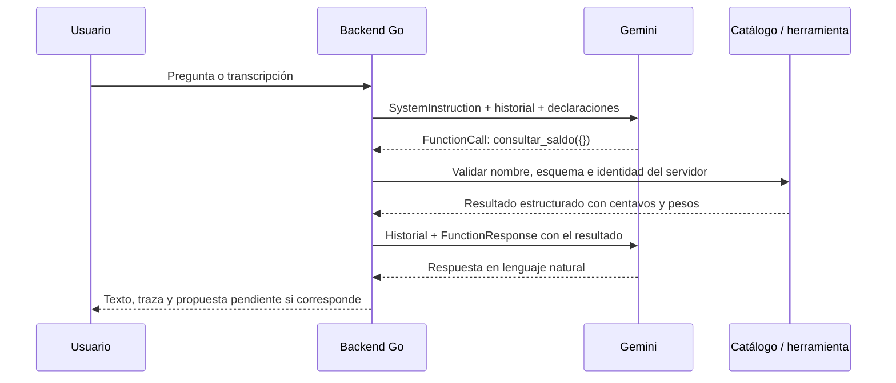

# Laboratorio local de texto y voz de Vera

Abre Docker Desktop y haz doble clic en **`Probar-Vera-Voz.cmd`**. El navegador
se abre cuando el servidor está listo. Mantén la ventana de CMD abierta; Ctrl+C
la detiene. El lanzador carga `.env.local` sin enviar la clave al navegador.

En la pantalla puedes escribir, pulsar **Hablar** y después **Detener y enviar**,
ver la transcripción y revisar las herramientas utilizadas. **Escuchar respuesta**
lee el texto final; puedes elegir una voz disponible o activar la lectura
automática. Grabar detiene la lectura anterior para evitar capturar a Vera.

La entrada de voz funciona por clips de hasta **20 segundos**, no como una
llamada de audio simultánea. La salida de voz es lectura del navegador, no una
voz personalizada entrenada para Vera. Si no existe una voz es-CO, se elige
otra voz española disponible; puedes cambiarla en el selector.

## Qué es real y qué es de prueba

El modo normal llama a Gemini. Las herramientas, validación y orquestación
son las del backend, con puertos financieros ficticios: el saldo, destinatarios
y movimientos pertenecen al sandbox. Ninguna propuesta ejecuta dinero.

Para probar la pantalla sin cuota:

```powershell
.\Probar-Vera-Voz.cmd -Demo
```

La demo tiene una pregunta y transcripción fijas («¿Cuánto tengo?»). Sirve para
verificar captura, formato, transporte, catálogo, traza y reproducción; no mide
la capacidad de Gemini para entender lo que dices. El modo normal usa su
transcripción real. No uses datos personales en las pruebas.

La sesión tiene **20 solicitudes** por defecto, compartidas entre texto y
transcripción. Un audio añade una llamada de transcripción a las necesarias
para contestar. El navegador muestra el consumo; «Nueva conversación» borra el
contexto pero conserva ese contador. No hay reintentos automáticos ni cambio
de modelo. Para un límite distinto: `Probar-Vera-Voz.cmd -MaxSolicitudes 10`.

El audio y el historial permanecen en memoria. Los bytes de audio recibidos se
limpian después de transcribir; el navegador conserva la última grabación para
que puedas reproducirla hasta reemplazarla, reiniciar la conversación o cerrar
la página. Esta herramienta no escribe grabaciones en archivos. El modo real
transmite el audio a Google para transcribirlo.

## Cómo Gemini actúa como Vera

Gemini recibe una petición construida por el backend en cada vuelta. No se ha
entrenado un modelo nuevo para esta identidad. Se le envían tres elementos:

1. **`SystemInstruction`**: el texto versionado de `instrucciones.go` comienza
   «Eres Vera, el asistente de la billetera Vera». Define idioma, tono, alcance,
   reglas financieras, tratamiento de datos no confiables, aclaraciones y
   confirmación. El backend añade la fecha de Colombia y los rangos relativos
   ya calculados. Cambiar este texto cambia su versión.
2. **Historial**: mensajes de usuario, respuestas anteriores, llamadas y
   resultados de herramientas. El modelo recibe ese contexto nuevamente en
   cada solicitud; la memoria de la conversación la mantiene la aplicación.
3. **Declaraciones de funciones**: el catálogo cerrado de siete herramientas.
   Cada declaración incluye `Name`, `Description` y `ParametersJsonSchema`.
   Explica qué hace la función y la forma exacta de sus argumentos.

El adaptador de Gemini transforma estos elementos en
`GenerateContentConfig.SystemInstruction`, `Tools.FunctionDeclarations` y
`Content`. El modo de llamadas es `AUTO`: según el mensaje y esas definiciones,
el modelo puede responder, preguntar algo que falta o solicitar funciones.

Por ejemplo, `consultar_saldo` no acepta parámetros. Su declaración indica que
consulta disponible y retenido del usuario autenticado. El JSON Schema tiene
`type: object`, sin propiedades y con `additionalProperties: false`. Una petición
«¿Cuánto tengo?» puede producir una respuesta estructurada como:

```json
{"name":"consultar_saldo","args":{}}
```

Eso **es una petición de ejecución**, no código ejecutado por Gemini. El modelo
no recibe una conexión a PostgreSQL, la clave de acceso del backend ni una
capacidad directa de mover dinero.

## El ciclo de function calling



`Orquestador.Responder` examina la respuesta. Si contiene llamadas, el catálogo
Go comprueba que el nombre exista y que los argumentos cumplan el esquema;
normaliza y valida celulares, fechas, llaves y montos. La identidad y la
conversación llegan del contexto del servidor, nunca de un `usuario_id`
inventado por el modelo. El registro de manejadores decide qué código se ejecuta.

El resultado se devuelve con el identificador de la llamada mediante
`FunctionResponse`. Así Gemini puede incorporar el saldo o decidir un siguiente
paso, por ejemplo buscar un destinatario y después preparar usando su referencia.
Un error de herramienta también vuelve como resultado estructurado.

Hay topes de cinco vueltas y ocho llamadas a herramientas por ciclo. Las
lecturas independientes pueden ejecutarse en paralelo; las preparaciones
mantienen el orden. Los importes se representan mediante `nucleo.Centavos`
(`int64`), y las funciones devuelven pesos ya formateados. Las instrucciones
exigen copiarlos. Eso orienta la respuesta del modelo; su exactitud narrativa
se sigue comprobando con las evaluaciones y no se garantiza sólo con el prompt.

## Qué cambia cuando hablas

El navegador solicita permiso al micrófono mediante `getUserMedia`. Un
`AudioWorklet` recoge PCM; la interfaz lo convierte a WAV mono de 16 kHz y 16
bits, compatible con la validación existente. No se usa reconocimiento de voz
del navegador para transcribir.

`/api/transcribir` valida tamaño y contenedor y llama al mismo protocolo de
transcripción del backend: `SoloTranscripcion=true`, sin herramientas, y salida
JSON con una clave `transcripcion`. Se comprueba esa salida antes de mostrarla.
La pantalla pasa el texto a `/api/preguntar`, reutilizando el ciclo de arriba.

La respuesta final puede leerse con `SpeechSynthesis`. Esto no necesita otra
llamada a Gemini; las voces y su disponibilidad dependen del navegador y del
sistema. La aplicación no afirma que todas esas voces funcionen sin conexión.

Referencias del navegador:
[captura del micrófono](https://developer.mozilla.org/en-US/docs/Web/API/MediaDevices/getUserMedia),
[AudioWorklet](https://developer.mozilla.org/en-US/docs/Web/API/AudioWorklet),
[SpeechSynthesis](https://developer.mozilla.org/en-US/docs/Web/API/SpeechSynthesis).

## Alcance y verificaciones

El laboratorio escucha en el equipo local. Docker publica el puerto únicamente
en `127.0.0.1`. Las rutas de prueba exigen un token aleatorio de sesión, distinto
de la clave de Gemini, y rechazan hosts y orígenes ajenos. El token llega en el
fragmento del enlace del lanzador y se mantiene en `sessionStorage`; no es la
autenticación de producción. Estas rutas no se añaden al OpenAPI público.

Se prueban sin red: autorización local, traza de función y resultado, validación
de WAV, cuota compartida, reinicio sin recuperar cuota, codificación de audio
48/44,1 kHz a 16 kHz y límite de 20 segundos. La demo se revisó en navegador,
incluyendo respuesta, traza y activación de lectura. La prueba manual de tu
micrófono y la comprensión del audio por Gemini real requieren el modo normal.

Archivos principales: `cmd/laboratorio-vera/main.go`,
`internal/copilot/laboratorio/servidor.go`, `internal/copilot/instrucciones.go`,
`internal/copilot/herramientas_esquemas.go`, `internal/copilot/orquestador.go` y
`internal/copilot/gemini/traduccion.go`.
