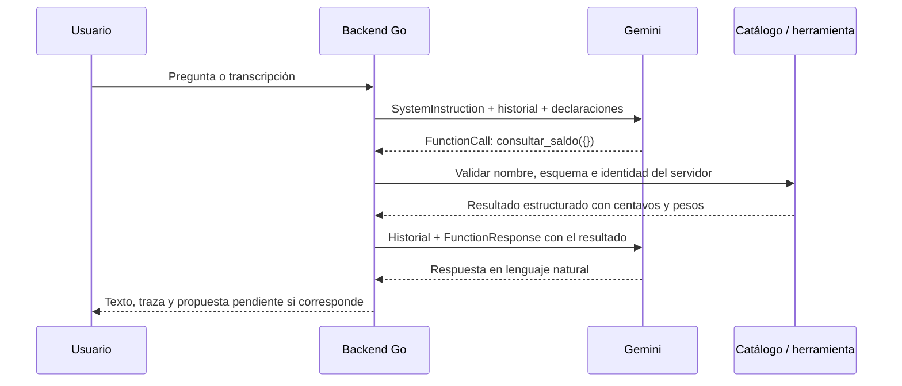

# Laboratorio local de texto y voz de Vera

Abre Docker Desktop y haz doble clic en **`Probar-Vera-Voz.cmd`**. El navegador
se abre cuando el servidor está listo. Mantén la ventana de CMD abierta; Ctrl+C
la detiene. El lanzador carga `.env.local` sin enviar la clave al navegador.
Prefiere el puerto 8787; si está ocupado, elige otro disponible y abre la dirección
correspondiente automáticamente.

En la pantalla puedes escribir, pulsar **Hablar** y después **Detener y enviar**,
ver la transcripción y revisar las herramientas utilizadas. **Escuchar respuesta**
lee el texto final; puedes elegir una voz disponible o activar la lectura
automática, activada inicialmente. Grabar detiene la lectura anterior para evitar capturar a Vera.

La entrada de voz funciona por clips de hasta **20 segundos**, no como una
llamada de audio simultánea. En modo normal, la salida es audio generado por
**Gemini 3.8 Flash-Lite TTS**, con **Aoede** como voz inicial. También puedes elegir
Kore, Puck o una voz del navegador. El estilo pide español de Colombia, calidez,
ritmo conversacional y pronunciación clara de cifras. El acento final depende
del modelo; no es una voz personalizada entrenada para Vera.

## Qué es real y qué es de prueba

El modo normal llama a Gemini. Las herramientas, validación y orquestación
son las del backend, con puertos financieros ficticios: el saldo, destinatarios
y movimientos pertenecen al sandbox. Ninguna propuesta ejecuta dinero.

Para probar la pantalla sin cuota:

```powershell
.\Probar-Vera-Voz.cmd -Demo
```

La demo tiene una pregunta y transcripción fijas («¿Cuánto tengo?»). Sirve para
verificar captura, formato, transporte, catálogo, traza y reproducción; no mide
la capacidad de Gemini para entender lo que dices. El modo normal usa su
transcripción real. No uses datos personales en las pruebas.

La sesión tiene **20 solicitudes** por defecto, compartidas entre texto,
transcripción y síntesis de voz. Un turno hablado añade una llamada de
transcripción y una de síntesis a las necesarias para contestar. La síntesis
ocurre después de mostrar el texto. Repetir la última respuesta con la misma
voz reutiliza el audio en memoria; cambiar la voz vuelve a generarlo. La demo
usa únicamente la voz del navegador y no consume Google.
El navegador muestra el consumo; «Nueva conversación» borra el
contexto pero conserva ese contador y las esperas por cuota de Google. Ante
timeout o indisponibilidad hay como máximo un reintento automático, contado
como otra solicitud. No se reintentan automáticamente cuota, credenciales ni
bloqueos; tampoco audio que ya comenzó a reproducirse. No hay cambio de modelo.
Para un límite distinto: `Probar-Vera-Voz.cmd -MaxSolicitudes 10`.

El audio y el historial permanecen en memoria. Los bytes de audio recibidos se
limpian después de transcribir; el navegador conserva la última grabación para
que puedas reproducirla hasta reemplazarla, reiniciar la conversación o cerrar
la página. Esta herramienta no escribe grabaciones en archivos. El modo real
transmite el audio a Google para transcribirlo y el texto final para sintetizarlo.
El adaptador TTS envía `store=false` para desactivar el almacenamiento de la
interacción recuperable en Google; esto no sustituye los términos de uso y
tratamiento de datos del Free Tier.

## Cómo Gemini actúa como Vera

Gemini recibe una petición construida por el backend en cada vuelta. No se ha
entrenado un modelo nuevo para esta identidad. Se le envían tres elementos:

1. **`SystemInstruction`**: el texto versionado de `instrucciones.go` comienza
   «Eres Vera, el asistente de la billetera Vera». Define idioma, tono, alcance,
   reglas financieras, tratamiento de datos no confiables, aclaraciones y
   confirmación. El backend añade la fecha de Colombia y los rangos relativos
   ya calculados. Cambiar este texto cambia su versión.
2. **Historial**: mensajes de usuario, respuestas anteriores, llamadas y
   resultados de herramientas. El modelo recibe ese contexto nuevamente en
   cada solicitud; la memoria de la conversación la mantiene la aplicación.
3. **Declaraciones de funciones**: el catálogo cerrado de siete herramientas.
   Cada declaración incluye `Name`, `Description` y `ParametersJsonSchema`.
   Explica qué hace la función y la forma exacta de sus argumentos.

El adaptador de Gemini transforma estos elementos en
`GenerateContentConfig.SystemInstruction`, `Tools.FunctionDeclarations` y
`Content`. El modo de llamadas es `AUTO`: según el mensaje y esas definiciones,
el modelo puede responder, preguntar algo que falta o solicitar funciones.

Por ejemplo, `consultar_saldo` no acepta parámetros. Su declaración indica que
consulta disponible y retenido del usuario autenticado. El JSON Schema tiene
`type: object`, sin propiedades y con `additionalProperties: false`. Una petición
«¿Cuánto tengo?» puede producir una respuesta estructurada como:

```json
{"name":"consultar_saldo","args":{}}
```

Eso **es una petición de ejecución**, no código ejecutado por Gemini. El modelo
no recibe una conexión a PostgreSQL, la clave de acceso del backend ni una
capacidad directa de mover dinero.

## El ciclo de function calling



`Orquestador.Responder` examina la respuesta. Si contiene llamadas, el catálogo
Go comprueba que el nombre exista y que los argumentos cumplan el esquema;
normaliza y valida celulares, fechas, llaves y montos. La identidad y la
conversación llegan del contexto del servidor, nunca de un `usuario_id`
inventado por el modelo. El registro de manejadores decide qué código se ejecuta.

El resultado se devuelve con el identificador de la llamada mediante
`FunctionResponse`. Así Gemini puede incorporar el saldo o decidir un siguiente
paso, por ejemplo buscar un destinatario y después preparar usando su referencia.
Un error de herramienta también vuelve como resultado estructurado.

Hay topes de cinco vueltas y ocho llamadas a herramientas por ciclo. Las
lecturas independientes pueden ejecutarse en paralelo; las preparaciones
mantienen el orden. Los importes se representan mediante `nucleo.Centavos`
(`int64`), y las funciones devuelven pesos ya formateados. Las instrucciones
exigen copiarlos. Eso orienta la respuesta del modelo; su exactitud narrativa
se sigue comprobando con las evaluaciones y no se garantiza sólo con el prompt.

## Qué cambia cuando hablas

El navegador solicita permiso al micrófono mediante `getUserMedia`. Un
`AudioWorklet` recoge PCM; la interfaz lo convierte a WAV mono de 16 kHz y 16
bits, compatible con la validación existente. No se usa reconocimiento de voz
del navegador para transcribir.

`/api/transcribir` valida tamaño y contenedor y llama al mismo protocolo de
transcripción del backend: `SoloTranscripcion=true`, sin herramientas, y salida
JSON con una clave `transcripcion`. Se comprueba esa salida antes de mostrarla.
La pantalla pasa el texto a `/api/preguntar`, reutilizando el ciclo de arriba.

`/api/voz` acepta únicamente el nombre de una de las tres voces; recupera el
texto de la última respuesta en el servidor. No acepta texto arbitrario ni
invoca herramientas. `SintetizadorVoz` separa esta capacidad del proveedor del
chat. Su adaptador usa `POST /v1beta/interactions`, la misma `GEMINI_API_KEY`,
el modelo fijo `gemini-3.8-flash-lite-tts` y `speech_metadata.style` separado del texto
literal. Devuelve WAV PCM mono de 24 kHz y 16 bits. El adaptador tiene timeout de
45 segundos, límites de respuesta y una sola solicitud por intento. El control
del laboratorio puede reintentar una vez un fallo transitorio antes del primer
PCM, siempre dentro del plazo global y del presupuesto de sesión.

El adaptador también ofrece `SintetizarFlujo`: una solicitud SSE a Google con
`stream=true` y salida PCM16 mono de 24 kHz. `/api/voz/flujo` retransmite los
fragmentos como envelopes NDJSON y hace flush de cada uno. El navegador agenda
los fragmentos con Web Audio, con un margen inicial de 60 ms, mientras llega
el resto. Los fragmentos deben terminar con una confirmación explícita; un
corte cancela la reproducción pendiente y no se guarda como caché válida.
Al completar la transmisión se construye un WAV para repetir la respuesta.
El endpoint WAV anterior se conserva como alternativa compatible.

El servidor y el navegador conservan sólo el último audio y la voz seleccionada.
Cambiar de turno o reiniciar la conversación limpia esa caché. Si TTS falla
antes de reproducir audio, la respuesta escrita permanece y la opción «Usar voz
del navegador si falla la voz natural» activa `SpeechSynthesis`, sin otra llamada
a Gemini. Se puede desmarcar. Un audio interrumpido a mitad no se repite
automáticamente. La disponibilidad de la lectura depende del navegador y del sistema.
La aplicación no afirma que todas esas voces funcionen sin conexión. Si el
navegador bloquea la reproducción automática, «Escuchar respuesta» reproduce
el audio ya generado sin consumir otra llamada.

Elección: TTS conserva el orquestador y las cifras actuales y añade expresividad
al texto terminado. Live API requeriría otra sesión y otro ciclo de audio y
herramientas. Google Cloud Text-to-Speech requiere su propia configuración de
facturación. Gemini TTS usa la clave existente y ofrece Free Tier según la
[tabla de precios](https://ai.google.dev/gemini-api/docs/pricing#gemini-3.8-flash-lite-tts)
consultada el 20 de octubre de 2026. Las cuotas dependen del proyecto; no se
habilita facturación desde este laboratorio.

Referencia de [síntesis Gemini](https://ai.google.dev/gemini-api/docs/speech-generation)
y [almacenamiento de interacciones](https://ai.google.dev/gemini-api/docs/interactions-overview).

## Latencia del laboratorio

El modo interactivo arranca con `-intervalo=0`: no impone una pausa entre
transcripción, vueltas del modelo y síntesis. Antes usaba un intervalo mínimo
de 12 segundos entre inicios de solicitudes, incluso entre modelos distintos.
El evaluador por lotes conserva su configuración de intervalo. Se mantiene el
tope de 20 solicitudes, sin reintentos ni ampliación de cuota ante un 429.

La voz usa Flash-Lite TTS, orientado a menor latencia, con las mismas opciones
de voz. El texto aparece antes del audio y la reproducción empieza al recibir
PCM, sin esperar el WAV completo. Tampoco se relee `/api/estado` entre etapas
que ya devolvieron el contador; se consulta al recuperarse de un error.

La pantalla mide transcripción, respuesta y primera voz del último turno.
«Primera voz» mide la llegada del primer fragmento, al que se añade el margen
de reproducción y la latencia del dispositivo. No mide sólo cómputo del modelo.

Prueba real del 20 de octubre de 2026: dos solicitudes con texto ficticio, una
por modo, al mismo modelo Flash-Lite y Aoede. Esperar el WAV completo tardó
3516 ms; en streaming, el primer PCM llegó a los 579 ms y la generación terminó
a los 1807 ms para un audio de 8,68 segundos. Son observaciones individuales,
sin mediana ni garantía de latencia; no incluyen transcripción ni chat. Informe:
`docs/evaluaciones/latencia-voz.json`; audio: `docs/evaluaciones/vera-voz-rapida.wav`.

Todavía hay una secuencia transcripción → orquestador → síntesis. Gemini Live
podría solapar entrada y salida en una sesión de audio, pero requiere integrar
sesiones, detección de turnos, interrupciones y llamadas al catálogo. La mejora
actual conserva las validaciones y los cálculos existentes del backend.

Referencias del navegador:
[captura del micrófono](https://developer.mozilla.org/en-US/docs/Web/API/MediaDevices/getUserMedia),
[AudioWorklet](https://developer.mozilla.org/en-US/docs/Web/API/AudioWorklet),
[SpeechSynthesis](https://developer.mozilla.org/en-US/docs/Web/API/SpeechSynthesis).

## Alcance y verificaciones

### Recuperación y revisión del flujo

- Un 429 conserva únicamente la dimensión pública de cuota y `RetryInfo` de
  Google. Se diferencia minuto, día o dimensión desconocida. Chat/transcripción
  y TTS mantienen pausas independientes; una petición durante la pausa no llega
  al proveedor ni consume una reserva. El corte diario se calcula en
  `America/Los_Angeles`, incluido horario de verano. Una espera sugerida no
  garantiza que Google conceda capacidad al terminar.
- El navegador deja de bloquear toda la sesión por un 429 temporal. Muestra
  una cuenta regresiva y vuelve a habilitar el reintento manual. Agotar las 20
  llamadas locales sigue siendo un límite distinto. Nueva conversación no
  reinicia ninguno de esos presupuestos.
- «Reintentar respuesta» conserva la pregunta o transcripción después de un
  fallo sin volver a grabar ni transcribir. El historial y la acción del sandbox
  se restauran si el turno falla. Los reintentos de red sólo repiten generación
  de modelo, no las funciones ya ejecutadas en esa vuelta.
- «Cancelar consulta» aborta la petición y los buffers de voz. El cliente tiene
  un plazo para conexión y lectura del cuerpo completo. El orquestador conserva
  su tope de 45 segundos; HTTP reserva margen para devolver un error legible.
- El perfil interactivo utiliza la temperatura predeterminada de Gemini, no
  fuerza cero. No añade el marcador privado del evaluador por lotes. La línea
  base por lotes conserva su protocolo y su marcador. Los filtros de contenido
  y la defensa contra filtración de instrucciones siguen activos.
- Al crear una propuesta válida, el laboratorio cierra con una plantilla del
  backend: relee acción, monto y vencimiento desde el servidor y exige confirmar
  en la tarjeta. No vuelve al modelo para redactar esa confirmación. La interfaz
  identifica «CONFIRMACIÓN DEL BACKEND» y sigue sin ejecutar dinero. Es una
  opción del orquestador habilitada por el perfil del laboratorio; el resto de
  integraciones conserva su configuración actual.

En la revisión real del 20 de octubre se verificaron audio sintético →
transcripción → respuesta → voz, saldo, límites, movimientos y resumen. Se
reprodujo un `ProviderSafety` después de preparar: la búsqueda y la preparación
habían terminado, pero falló la redacción del modelo. La corrección se verificó
con otra preparación real de sandbox: dos llamadas, tarjeta y texto calculado
por el backend, sin ejecutar dinero. Total de la revisión y confirmación: 17
solicitudes. Evidencia: `docs/evaluaciones/revision-flujo.json` conserva el fallo
inicial y `docs/evaluaciones/revision-preparacion.json` el resultado corregido.

Hay pruebas sin red de cuota minuto/día, expiración del cooldown, aislamiento de
voz/chat, cancelación, presupuesto de reintentos, protección de instrucciones,
descarte de audio parcial y confirmación de propuesta sin otra llamada al
modelo. En navegador se simularon cuota temporal, bloqueo, cancelación y fallo
transitorio para comprobar controles y lectura de respaldo. Esta revisión no
garantiza disponibilidad de Google ni sustituye la línea base de calidad.

Los bloqueos se diagnostican por origen: filtro de entrada de Google
(`ProviderInput`), filtro de salida (`ProviderSafety`), reproducción de contenido
(`ProviderRecitation`), información sensible (`ProviderSensitiveData`), motivo
no especificado (`ProviderOther`) o copia de instrucciones detectada en el
backend (`InstructionDisclosure`). Todos conservan la categoría `ResponseBlocked`;
el mensaje sólo contiene motivos de una lista cerrada, nunca el texto bloqueado,
las instrucciones ni mensajes internos del SDK. No se relajan filtros ni se
reintentan bloqueos automáticamente. Una transcripción correcta seguida de un
fallo al responder se identifica expresamente en la pantalla.

El saludo «Hola, Vera, ¿cómo estás?» se comprobó en una conversación nueva con
el proveedor real: respondió en una llamada. No se reprodujo el bloqueo reportado;
no se atribuye a Google o al backend sin el diagnóstico correspondiente.

El laboratorio escucha en el equipo local. Docker publica el puerto únicamente
en `127.0.0.1`. Las rutas de prueba exigen un token aleatorio de sesión, distinto
de la clave de Gemini, y rechazan hosts y orígenes ajenos. El token llega en el
fragmento del enlace del lanzador y se mantiene en `sessionStorage`; no es la
autenticación de producción. Estas rutas no se añaden al OpenAPI público.

Se prueban sin red: autorización local, traza de función y resultado, validación
de WAV, cuota compartida, reinicio sin recuperar cuota, codificación de audio
48/44,1 kHz a 16 kHz y límite de 20 segundos. La demo se revisó en navegador,
incluyendo respuesta, traza y activación de lectura. La prueba manual de tu
micrófono y la comprensión del audio por Gemini real requieren el modo normal.
La integración TTS tiene pruebas con HTTP simulado para texto literal, voz,
cuota, errores sin reintentos, salida inválida y caché del último turno.
Se realizó además una solicitud real de síntesis con texto ficticio y Aoede;
la muestra de 8,64 segundos está en `docs/evaluaciones/vera-voz-aoede.wav`.
Esa muestra corresponde al modelo anterior Flash TTS; la prueba Flash-Lite y
sus tiempos se describen arriba. Las pruebas de streaming verifican entrega
antes del fin, caché sin cuota adicional, fragmentos divididos, orden de PCM,
cancelación y descarte de transmisiones incompletas. La interfaz se comprueba
con audio guardado sin repetir llamadas a Google.

Archivos principales: `cmd/laboratorio-vera/main.go`,
`internal/copilot/laboratorio/servidor.go`, `internal/copilot/instrucciones.go`,
`internal/copilot/herramientas_esquemas.go`, `internal/copilot/orquestador.go` y
`internal/copilot/gemini/traduccion.go`.
